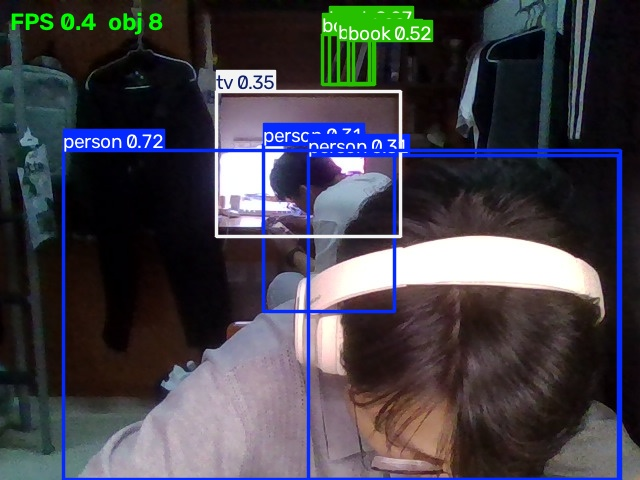

# YOLO 摄像头实时目标检测

一个最小的视觉识别实践：打开摄像头，用 YOLO 预训练模型实时检测画面中的物体，画框、标类别、显示置信度。



---

## 1. 实现了什么

- 调用电脑自带 / 外接摄像头，实时读取视频流
- 用 YOLO11 预训练模型（COCO 80 类）检测画面中的物体
- 在画面上绘制：检测框、类别名、置信度
- 左上角显示实时 FPS 和当前帧的物体数
- 每 30 帧在终端打印一次检测结果汇总（如 `帧 30: 4 个物体 [personx2, laptopx1, cupx1] FPS 18.3`）
- 支持按 `q` 或 `ESC` 退出，按 `s` 保存当前画面
- 支持无窗口模式（`--no-display`），适合在服务器或自动化测试里跑
- 支持截图模式（`--save`），跑一帧就保存并退出

---

## 2. 运行环境

| 项目 | 版本 |
| --- | --- |
| 操作系统 | Windows 11（也可在 Ubuntu 下运行，代码无平台依赖） |
| Python | 3.12.15（Anaconda 发行版） |
| ultralytics | 8.4.197 |
| opencv-python | 5.0.0 |
| torch | 2.14.1+cu130 |
| numpy | 2.5.4 |

**关于 GPU**：本机有 NVIDIA 显卡，torch 是 CUDA 版。但 YOLO11n 很小，CPU 也能跑到 15-25 FPS，所以有没有 GPU 都能用。

---

## 3. 怎么跑

### 3.1 创建环境

用 Conda（推荐，能隔离依赖）：

```bash
conda create -n perception python=3.12
conda activate perception
```

或者用 venv：

```bash
python -m venv .venv
# Windows
.venv\Scripts\activate
# Linux / macOS
source .venv/bin/activate
```

### 3.2 安装依赖

```bash
pip install -r requirements.txt
```

> **注意**：`ultralytics` 会自动带上 `torch` 和 `torchvision`。
> 如果你想要 GPU 版本，先按 [PyTorch 官网](https://pytorch.org/get-started/locally/) 的说明装好 CUDA 版 torch，再装 ultralytics —— pip 会保留已装的 torch，不会覆盖。

### 3.3 运行

```bash
# 默认：摄像头索引 0，模型 yolo11n，分辨率 640
python src/detect.py

# 第二个摄像头
python src/detect.py --source 1

# 换更大更准的模型（首次运行自动下载）
python src/detect.py --model yolo11s.pt

# 只显示高置信度的
python src/detect.py --conf 0.5

# 不开窗口，跑 100 帧看平均 FPS
python src/detect.py --no-display --max-frames 100

# 保存一张带标注的截图后退出
python src/detect.py --no-display --save docs/screenshot.jpg
```

### 3.4 参数说明

| 参数 | 默认 | 作用 |
| --- | --- | --- |
| `--source` | `0` | 摄像头索引，或视频文件路径 |
| `--model` | `yolo11n.pt` | 模型权重。n 最快，s/m/l/x 更准但更慢 |
| `--conf` | `0.25` | 置信度阈值。调高只留确定的，调低能看到更多（含误检） |
| `--classes` | 全部类别 | 只显示逗号分隔的类别名（如 `person,bus`），名称区分大小写；不传时显示全部 80 类 |
| `--imgsz` | `640` | 推理分辨率。降到 480/320 能显著提速 |
| `--device` | 自动 | `0` = 第一块 GPU，`cpu` = 强制 CPU，不填 = 有 GPU 就用 |
| `--no-display` | 关 | 不开窗口（无 GUI 环境用） |
| `--max-frames` | `0` | 跑多少帧后退出，0 = 一直跑 |
| `--save` | 无 | 保存一张标注图到指定路径后退出 |

---

## 4. 模型权重怎么获取

**不需要手动下载。** 第一次运行 `python src/detect.py` 时，`ultralytics` 会自动从 GitHub Releases 下载 `yolo11n.pt`（约 5.4 MB）到当前目录。

可选模型和大小：

| 模型 | 大小 | 速度 | 精度 |
| --- | --- | --- | --- |
| `yolo11n.pt` | 5.4 MB | 最快 | 够用 |
| `yolo11s.pt` | 18 MB | 中 | 更好 |
| `yolo11m.pt` | 39 MB | 慢 | 好 |
| `yolo11l.pt` / `yolo11x.pt` | 50 / 110 MB | 很慢 | 最好 |

**权重文件不要提交到 Git**（已在 `.gitignore` 里排除 `*.pt`）。

如果下载失败（网络问题），可以手动从 https://github.com/ultralytics/assets/releases 下载对应文件，放到项目根目录。

---

## 5. 运行效果

见上面那张图（`docs/screenshot.jpg`）。那是用 Ultralytics 官方的标准测试图
（`bus.jpg`，一张街景照片）跑出来的：

```bash
python src/detect.py --source path/to/bus.jpg --no-display --save docs/screenshot.jpg
```

检测到 6 个物体：`bus 0.94`、`person 0.88 / 0.86 / 0.82 / 0.63`。

**为什么用这张图而不是摄像头截图**：摄像头实拍会拍到私人环境，不适合放进公开仓库。
摄像头模式的代码路径和这张图完全一样 —— 只是输入源从文件换成 `cv2.VideoCapture(0)`，
本地跑 `python src/detect.py` 就能复现同样的效果。

平均帧率（本机实测，摄像头 640×480 输入、640 推理分辨率、yolo11n）：

| 设备 | FPS |
| --- | ---: |
| GPU（RTX 5060 Laptop） | **10.3** |
| CPU | 7.5 |

**为什么 GPU 提升不明显**：瓶颈不在推理，而在「摄像头读帧 + Python 循环 + 绘图」这条串行链路。
把 `--imgsz` 降到 480 或 320 能明显提速（推理时间少了），但摄像头本身只有 30 fps 上限。

```bash
# 想看更高帧率
python src/detect.py --imgsz 320
```

---

## 6. 遇到的典型问题和解决办法

### 问题 1：`打不开 0`（摄像头打不开）

**原因**：摄像头被别的程序占用（微信视频、Zoom、浏览器网页会议都会占用），或者索引不对。

**解决**：
1. 关掉所有可能用摄像头的程序
2. 试 `--source 1`（有些笔记本把内置摄像头排在 1）
3. 在设备管理器里确认摄像头状态正常

### 问题 2：首次运行卡在下载模型

**原因**：国内访问 GitHub Releases 慢。

**解决**：开代理，或者手动下载 `yolo11n.pt` 放到项目目录。

### 问题 3：FPS 很低（< 5）

**原因**：可能是第一次推理（模型预热 + CUDA 初始化），也可能是分辨率太高。

**解决**：
1. 跑够 30 帧再看 FPS（前几帧不做数）
2. 降分辨率：`--imgsz 480` 或 `--imgsz 320`
3. 确认 torch 用的是 GPU 还是 CPU：`python -c "import torch; print(torch.cuda.is_available())"`

### 问题 4：`pip install ultralytics` 反复超时

**原因**：`polars_runtime` 等依赖包比较大，网络不稳。

**解决**：重试（pip 会断点续传），或者换国内镜像：

```bash
pip install ultralytics -i https://pypi.tuna.tsinghua.edu.cn/simple
```

### 问题 5：Windows 上 `cv2.imshow` 窗口一闪而过

**原因**：没有加 `cv2.waitKey()` 的等待，或者主循环退出了。

**解决**：本脚本已经在每帧后调用 `cv2.waitKey(1)`，正常不会闪。

---

## 7. 从摄像头到检测结果的流程

```
摄像头
  ↓  cv2.VideoCapture(0).read()
一帧图像（numpy 数组，H×W×3，BGR 顺序）
  ↓  预处理：缩放、归一化、HWC→CHW、加 batch 维
张量（1×3×640×640）
  ↓  YOLO 前向推理
原始输出：每个格子的类别概率 + 框偏移 + 置信度
  ↓  NMS（非极大值抑制）
保留的检测框列表：[(x1,y1,x2,y2, conf, class_id), ...]
  ↓  r.plot()
带标注的图像（还是 numpy 数组）
  ↓  cv2.imshow()
屏幕上的窗口
```

**关键点**：
- 图像是 **BGR** 顺序（OpenCV 的传统），不是 RGB
- YOLO 内部会做 letterbox 缩放（保持长宽比，空白处填灰），推理后再映射回原图坐标
- NMS 是去掉重叠框的步骤 —— 同一个物体可能被多个格子检出，NMS 只留置信度最高的

---

## 8. 目录结构

```
perception-hw/
├── src/
│   └── detect.py           主程序
├── docs/
│   ├── screenshot.jpg      运行效果截图
│   ├── env-notes.md        环境管理学习记录
│   └── pcl-notes.md        PCL 预习笔记
├── requirements.txt        依赖清单
├── .gitignore
└── README.md
```

---

## 9. 参考

- [Ultralytics YOLO11 文档](https://docs.ultralytics.com/models/yolo11/)
- [OpenCV VideoCapture](https://docs.opencv.org/4.x/dd/d9e/classcv_1_1VideoCapture.html)
- [COCO 数据集 80 类列表](https://docs.ultralytics.com/datasets/detect/coco/)
